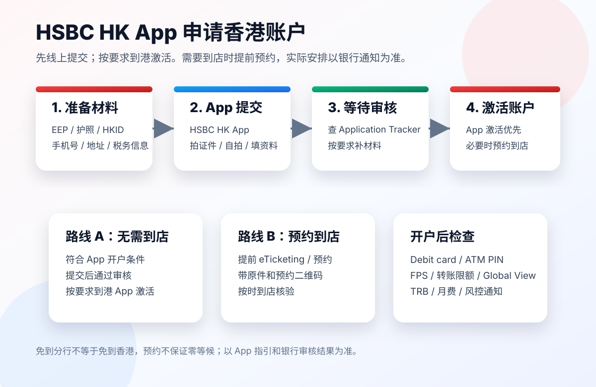

# HSBC 香港开户攻略：先 App 申请，再按要求到港激活

> 更新日期：2026-10-31。资格、激活期限和费用以 App、官网及审核通知为准。

合资格内地申请人可先通过 HSBC HK App 提交，再到香港通过 App 激活，减少分行办理。**免到分行不等于免到香港；预约也不保证现场零等候。**

## 一、准备材料

- 有效港澳通行证（EEP）及 App 要求的身份证件。
- 本人手机号、邮箱，以及支持拍照和身份验证的手机。
- 真实居住地址；如被要求，提供银行认可的地址证明。
- 税务居民国家、税务识别号、职业、开户用途及资金来源。

提前检查赴港所需证件和签注。不同证件、所在地及账户类型的申请路径可能不同。

## 二、先在 App 提交

1. 从[汇丰官网](https://www.hsbc.com.hk/ways-to-bank/mobile-apps/banking/)下载 HSBC HK App。
2. 选择“开立账户”或“还没有账户”，查看自己是否符合条件。
3. 按提示拍摄证件、完成人脸验证，填写个人及税务资料。
4. 提交申请，保留申请编号，按通知补交材料。

若 App 没有适用路径，先联系银行或预约分行；不要默认所有非香港身份证持有人都能线上开户。[查看 App 开户资格](https://www.hsbc.com.hk/ways-to-bank/mobile-apps/banking/account-opening/)

## 三、按要求到香港激活

HSBC 国际开户页面说明：人在中国大陆的合资格申请人可用 EEP 提交，须在 **90 天内到香港，通过 HSBC HK App 激活账户**，该路径无需亲临分行。[官方说明](https://www.hsbc.com.hk/international/banking-in-hong-kong/)

1. 确认获批状态和激活期限，再安排赴港行程。
2. 到香港后按 App 指引完成激活。
3. 如被要求到店，通过[分行服务页面](https://www.hsbc.com.hk/ways-to-bank/branch/)查询预约或 eTicketing，带齐原件、申请记录和预约凭证。

银行可能要求补充核验，不能保证每位申请人都免到分行。

## 四、账户费用

HSBC One 当前规定：2026 年 1 月 1 日或之后开户的非香港身份证持有人，连续 3 个月平均全面理财总值（TRB）达到 HKD10,000，可豁免每月 HKD100 的低额结存服务费。具体计算和豁免按银行条款执行。[费用说明](https://www.hsbc.com.hk/accounts/products/one/)

申请前看清余额要求，不要把“能开户”理解为一定没有维护费。

## 五、激活后检查

- App、网银登录和流动保安编码。
- 银行卡申请、领取或邮寄方式及 PIN 设置。
- 交易通知、转账限额、转数快及跨境转账费用。

## 官网入口

- [HSBC HK App 下载](https://www.hsbc.com.hk/ways-to-bank/mobile-apps/banking/)
- [App 开户条件](https://www.hsbc.com.hk/ways-to-bank/mobile-apps/banking/account-opening/)
- [内地及海外申请说明](https://www.hsbc.com.hk/international/banking-in-hong-kong/)
- [分行与预约服务](https://www.hsbc.com.hk/ways-to-bank/branch/)
