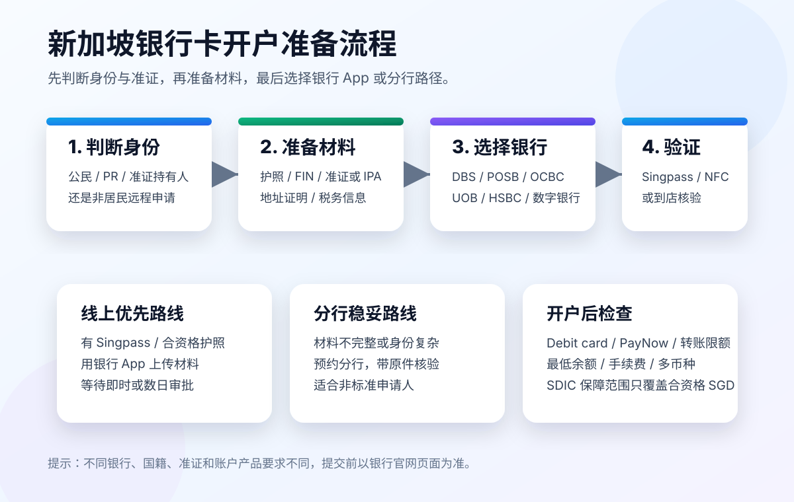

# 新加坡银行卡开户攻略：材料与办理步骤

> 更新日期：2026-10-31。申请资格、费用和结果以银行最新要求为准。

在新加坡工作、学习或居住，先按身份选择开户路径；短期游客不能默认按居民流程申请。

## 一、准备材料

- 有效护照。
- 新加坡准证、FIN 或银行认可的 IPA 等工作、学习、居住证明。
- 地址证明，例如银行账单、水电账单、租约或雇主信；期限和类型按银行要求。
- 税务居民国家及税务识别号（TIN）。
- 本人长期使用的手机号、邮箱；已有 Singpass 的可用于支持的线上流程。

文件中的姓名、地址应与申请表一致。IPA 能否使用、作为哪类证明，应看银行文件清单。

## 二、选择开户路径

| 情况 | 可查看的路径 |
| --- | --- |
| 已有新加坡准证或符合条件的 IPA | DBS/POSB，核对文件后通过 App 申请 |
| 计划赴新加坡工作、学习或居住，持合资格电子护照 | OCBC 外国人远程开户 |
| 已有国际银行关系 | 咨询 HSBC 等银行的国际开户服务 |
| 只有旅游身份 | 先向银行确认非居民资格，再安排申请 |

OCBC 当前远程申请路径支持年满 18 岁、持中国大陆、香港、马来西亚或印度尼西亚电子护照的合资格申请人，仍须完成证件验证和审核。[查看条件](https://www.ocbc.com/personal-banking/digital-banking/sg-bank-account.page)

## 三、办理步骤

1. 在官网确认资格、材料和账户费用。
2. 从官网下载银行 App，用 Singpass 或证件验证身份。
3. 填写地址、职业、开户用途、资金来源和税务信息，上传材料。
4. 保留申请编号，按通知补件；需要到店时先预约并带原件。
5. 获批后完成首次入金、卡片激活及安全设置。

**OCBC 远程开户：**当前页面要求开户后 90 天内，从本人名下银行账户单笔转入至少 S$3,000，不能从数字钱包转入。操作前再次核对最新要求。[来源](https://www.ocbc.com/personal-banking/digital-banking/sg-bank-account.page)

## 四、开户前后必看

- 开户前：最低余额、低余额管理费、首次入金、换汇及跨境转账费用。
- 开户后：借记卡领取方式、网银登录、交易通知和转账限额。
- 按实际情况填写地址、税务和资金来源，不委托“包开”中介保管账号或验证码。

## 官网入口

- [DBS：新到新加坡人士开户](https://www.dbs.com.sg/personal/deposits/for-foreigners/new-to-singapore)
- [DBS：开户文件清单](https://www.dbs.com.sg/personal/support/bank-account-opening-documents-required.html)
- [OCBC：外国人远程开户](https://www.ocbc.com/personal-banking/digital-banking/sg-bank-account.page)
- [HSBC Singapore：国际开户](https://www.hsbc.com.sg/international/open-an-account/)
